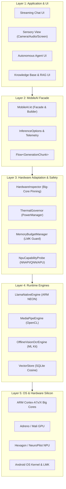
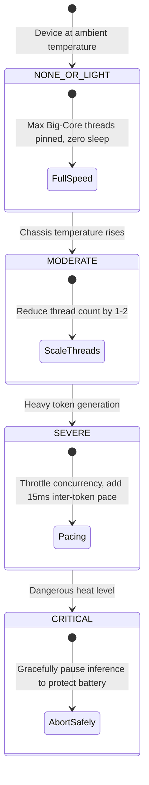
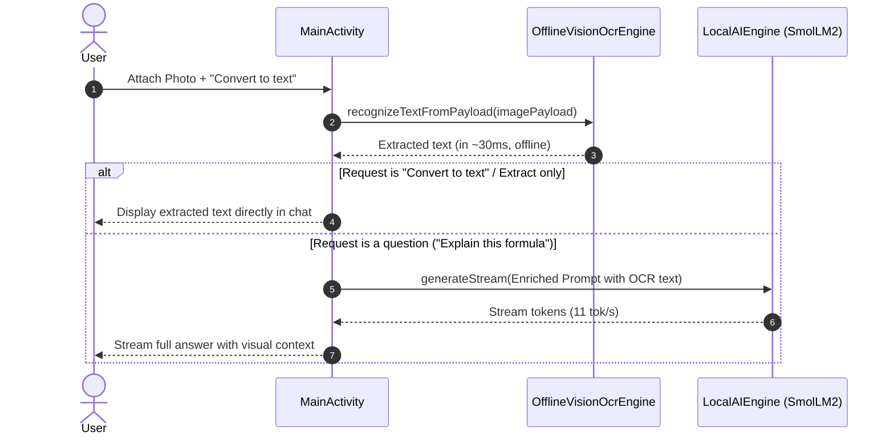

# 🏛️ MobileAI Framework Architecture & Systems Design

This document details the architectural principles, subsystems, and low-level mechanics of the **MobileAI Framework**.

---

## 1. System Topology & Layers

MobileAI is organized into decoupled layers to separate high-level Android UI presentation from hardware-dependent runtime kernels:



---

## 2. Hardware-Aware Inference Mechanics

### A. CPU Cluster Detection & Thread Pinning
Mobile SoCs group heterogeneous CPU cores into clusters:
- **Little Cores (Efficiency):** Low clock speed, low power, small L2 cache (e.g., Cortex-A55).
- **Big Cores (Performance):** High clock speed, large L2/L3 cache, wide SIMD pipelines (e.g., Cortex-A76, A78, X1-X4).

If an inference loop dispatches across all 8 cores uniformly, **A55 straggler threads** hold the barrier lock, slowing the entire model down to the speed of the slowest core.

MobileAI parses `/sys/devices/system/cpu/cpu*/cpufreq/cpuinfo_max_freq` at runtime:
```
Cluster 0 (Little): CPU 0-5 @ 2000 MHz
Cluster 1 (Big):    CPU 6-7 @ 2400 MHz
```
MobileAI computes `optimalBigCoreCount = totalBigCores - 1` (leaving 1 big core for Android UI/rendering), pins threads to this optimal set, and sets thread affinities in C++ / pthreads.

---

### B. Dynamic Thermal Governor State Machine
Mobile chips lack active fans. Continuous matrix multiplication causes temperature spikes of up to 1°C per 10 seconds. 

MobileAI listens to `PowerManager.OnThermalStatusChangedListener`:



---

### C. Low-Memory-Killer (LMK) Budget Guard
Android forcibly kills apps (`SIGKILL 9`) when available RAM drops below system thresholds. MobileAI calculates safety limits before model load:

$$\text{Budget Overhead} = \text{Model File Size} + \left(2 \times \text{layers} \times \text{heads} \times \text{head\_dim} \times \text{context\_length} \times \text{bytes\_per\_weight}\right)$$

If `systemAvailableMem - BudgetOverhead < 250\text{ MB}`, MobileAI drops context length:
- $2048 \to 1024 \to 512$
This ensures that the app never crashes due to an out-of-memory exception.

---

## 3. Multimodal & On-Device OCR Pipeline



---

## 4. On-Device SQLite Vector Store & RAG

MobileAI's `VectorStore` uses an embedded SQLite database storing text chunks alongside serialized float arrays:

- **Distance Metric:** Cosine similarity:
$$\text{Cosine}(\vec{u}, \vec{v}) = \frac{\sum_{i=1}^n u_i v_i}{\sqrt{\sum_{i=1}^n u_i^2} \sqrt{\sum_{i=1}^n v_i^2}}$$
- **Query Pipeline:**
  1. User enters natural language query.
  2. Query is converted to vector embedding via `mobileAI.embed(query)`.
  3. Vectors in namespace are queried with top-K cosine ranking.
  4. Top-ranked text chunks are formatted into an augmented prompt:
     `Context: [Retrieved Text] \n\n Question: [User Query]`.
  5. SLM generates accurate answer grounded in local documents.

---

## 5. Autonomous Device Agent

The agent is powered by `PhoneControllerAccessibilityService`:
1. **Perception:** Traverses active `AccessibilityNodeInfo` tree to extract clickable nodes, bounds, text labels, and input fields.
2. **Reasoning:** Local SLM (or Cloud model) evaluates current screen state against user's goal.
3. **Action:** Dispatches low-level Android gestures:
   - `performAction(ACTION_CLICK)`
   - `dispatchGesture(GestureDescription)` for swipes and scrolls
   - `performAction(ACTION_SET_TEXT)` for input entry
   - `performGlobalAction(GLOBAL_ACTION_HOME / BACK)`
