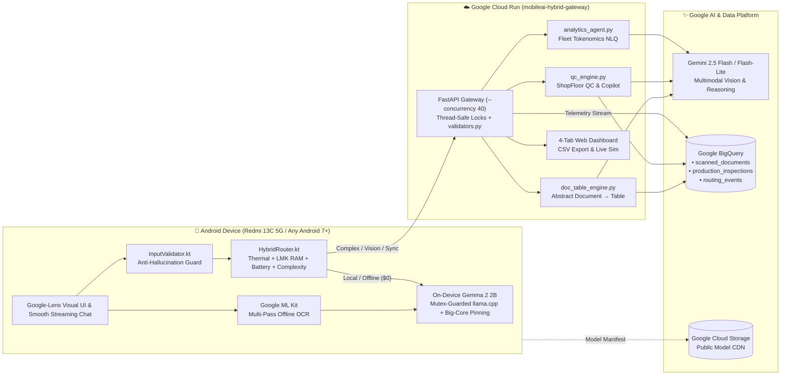

# 📱 MobileAI Framework — Edge-Cloud Hybrid AI & ShopFloor Lens

[](https://mobileai-hybrid-gateway-646100637693.us-central1.run.app)
[](https://ai.google.dev/gemma)
[](https://ai.google.dev/)
[](https://cloud.google.com/bigquery)
[](https://developer.android.com)
[](LICENSE)

> **Google DeepMind | Google Cloud Startup Buildathon India 2026**
>
> **🌐 Live Shareable Web App & Hybrid API Gateway:** https://mobileai-hybrid-gateway-646100637693.us-central1.run.app  
> **📦 Public GCS Model CDN Manifest:** https://storage.googleapis.com/mobileai-models-cdn-646100637693/models_manifest.json

**MobileAI Framework** is a production-ready **Edge-Cloud Hybrid AI runtime, Android Visual Lens app, and Google Cloud control plane** engineered for real-world field and manufacturing environments (**ShopFloor AI**). It combines **Google Gemma 2 2B** running locally on budget Android smartphones (`llama.cpp` ARM NEON) with **Gemini 2.5 Flash**, **Google Cloud Run**, **Google BigQuery**, and **Google Cloud Storage**—cutting cloud LLM spend by **60–80%** while guaranteeing **100% offline continuity** in dead zones and Airplane Mode.

---

## 🎯 Problem Statement & Solution Alignment

### The Problem
1. **Unreliable Connectivity on Shop Floors & Field Sites:** Factory floors, warehouses, and remote sites suffer from dead zones where cloud-only AI apps fail completely.
2. **Prohibitive Cloud Token Costs:** Routing every routine query, note summary, or OCR lookup to cloud APIs inflates enterprise AI spend and leaks sensitive operational data.
3. **Unstructured Paper & Messy Handwriting:** Quality inspection sheets, invoices, BOMs, and handwritten shift notes remain trapped on paper because rigid OCR parsers break on inconsistent formats and dirty handwriting.
4. **Mobile Hardware Instability:** Running SLMs naively on mid-range/budget Android phones triggers thermal throttling, Android Low-Memory-Killer (`SIGKILL`) crashes, and native JNI concurrency crashes.

### Our Solution
MobileAI introduces a **Hardware-Aware Hybrid Edge-Cloud Architecture**:
- **Intelligent Hybrid Router (`HybridRouter.kt`)**: Evaluates real-time **thermal status, free RAM (LMK guard < 900 MB), battery level, connectivity, and prompt complexity (0–100)** to run simple/private/offline tasks locally on **Gemma 2 2B at $0 cloud cost** and escalate heavy multimodal/reasoning queries to **Gemini 2.5 Flash**.
- **Google-Lens-Style Document-to-Abstract-Table Scanner**: Capture any handwritten note, invoice, checklist, or CNC inspection sheet → **Gemini 2.5 Flash Vision** extracts dynamic, schema-agnostic tables directly into **Google BigQuery (`scanned_documents`)** with **1-click CSV export**.
- **2-Stage Offline Vision Repair (Airplane Mode Ready)**: When offline, **Google ML Kit** runs multi-pass contrast-enhanced OCR, then pipes raw noisy handwriting into **on-device Gemma 2 2B** to denoise typos and synthesize structured pipe tables completely offline.
- **ShopFloor CNC QC Copilot & Fleet Tokenomics**: Natural-language **Query & Update** copilot over live BigQuery production telemetry (`production_inspections`, `routing_events`), protected by strict anti-hallucination validators (`validators.py` & `InputValidator.kt`).

---

## 🧠 Deep Google AI & Cloud Integration

| Google Technology | Role in MobileAI Framework | Implementation Reference |
| :--- | :--- | :--- |
| **Google Gemma 2 2B** (`gemma-2-2b-it-q4_k_m.gguf`) | Default on-device LLM via `llama.cpp` ARM NEON (`3.9–8 tok/s` on MediaTek Dimensity 6100+); powers zero-cost local chat & Stage-2 offline OCR denoising/table repair | [ModelFileManager.kt](app/src/main/java/com/phoneai/localmodel/ModelFileManager.kt), [LocalAIEngine.kt](app/src/main/java/com/phoneai/localmodel/LocalAIEngine.kt), [MainActivity.kt](app/src/main/java/com/phoneai/localmodel/MainActivity.kt) |
| **Gemini 2.5 Flash & Flash-Lite** | Multimodal Vision OCR (dirty handwriting + document layout), schema-agnostic JSON table extraction, ShopFloor QC Copilot (Query/Update), and BigQuery Conversational Analytics | [CloudAiClient.kt](app/src/main/java/com/mobileai/framework/cloud/CloudAiClient.kt), [doc_table_engine.py](server/doc_table_engine.py), [qc_engine.py](server/qc_engine.py), [analytics_agent.py](server/analytics_agent.py) |
| **Google ML Kit (On-Device Vision)** | 100% offline, zero-weight-overhead multi-pass optical character recognition with grayscale contrast stretching & resolution scaling | [OfflineVisionOcrEngine.kt](app/src/main/java/com/mobileai/framework/multimodal/OfflineVisionOcrEngine.kt) |
| **Google Cloud Run** | Serverless FastAPI Hybrid Gateway + interactive 4-tab Web Application (`--concurrency 40`, stress-tested 20/20 concurrent HTTP 200) | [server/main.py](server/main.py), [server/Dockerfile](server/Dockerfile), [server/static/index.html](server/static/index.html) |
| **Google BigQuery** | 3 live partitioned & clustered tables: `scanned_documents` (schema-agnostic tables), `production_inspections` (161+ live CNC QC records), `routing_events` (Edge/Cloud tokenomics telemetry) | [bigquery_schema.sql](server/bigquery_schema.sql), [qc_schema.sql](server/qc_schema.sql), [telemetry.py](server/telemetry.py) |
| **Google Cloud Storage (GCS)** | Public GGUF Model CDN hosting `models_manifest.json` and versioned quantized model distribution with SHA-256 verification | [ModelDownloadManager.kt](app/src/main/java/com/mobileai/framework/core/ModelDownloadManager.kt), [models_manifest.json](server/models_manifest.json) |

---

## 🏗️ End-to-End Edge-Cloud Architecture



---

## 🌟 Key Innovations & Differentiators

1. **2-Stage Offline Vision Repair (`ML Kit → Gemma 2 2B`):** Standard offline OCR garbles dirty handwriting. When disconnected or in Airplane Mode, MobileAI automatically feeds raw ML Kit extractions into on-device **Gemma 2 2B** to reconstruct corrupted tokens and format clean pipe-delimited tables with zero cloud dependency.
2. **Hardware-Aware Hybrid Tokenomics Router:** Unlike static cloud wrappers, `HybridRouter` probes real Android hardware signals—**CPU big.LITTLE cluster frequencies**, **`PowerManager` thermal state**, **available RAM (LMK guard < 900 MB)**, **battery level**, and **intent/complexity scoring**—saving **60–80%** on cloud API spend while preventing OOM crashes and thermal runaway.
3. **Schema-Agnostic Document-to-BigQuery Digitizer:** Instead of brittle fixed-template forms, any unstructured document (handwritten notes, delivery challans, BOMs, inspection logs) is dynamically converted into self-describing `columns_json` + `rows_json` records in BigQuery (`scanned_documents`) and rendered immediately as filterable HTML tables with 1-click CSV export.
4. **Production-Hardened Safety & Concurrency:**
   - **Zero JNI Crashes:** `kotlinx.coroutines.sync.Mutex` serializes all `llama.cpp` native calls + active inference guards prevent rapid-tap `SIGSEGV` crashes.
   - **Zero Hallucination / DB Pollution:** Synchronized `validators.py` (server) and `InputValidator.kt` (Android) reject gibberish (`asdfghjkl`), empty inputs, non-dimensional scans, and physically impossible tolerances before touching Gemini or BigQuery.

---

## 📱 Mobile UX & Web Dashboard Highlights

### Android App (Streamlined 2-Tab Experience)
- **💬 Chat Tab:** Smooth, zero-jitter token streaming (`itemAnimator = null` + payload-based `ChatAdapter` updates), live route badge (`Local Gemma 2 2B` vs `Cloud Gemini`), token/sec telemetry, and photo-attached **Ask AI** with automatic offline OCR fallback.
- **📷 Google-Lens Visual Tab:** Full-viewport immersive camera preview with subtle top scrim, delicate rounded corner scan arcs, circular Gallery & Camera Flip controls, translucent halo shutter button, and a frosted dark-glass 4-mode dock:
  - `📄 Doc Table` — Scan any document/handwriting → structured table saved to BigQuery (`scanned_documents`)
  - `📝 Handwrite` — Gemini 2.5 Flash handwriting transcription online / 2-stage ML Kit + Gemma 2 2B offline
  - `🏭 QC Check` — Scan CNC vernier/inspection sheets → live `PASS`/`FAIL` verification in BigQuery
  - `✨ Ask AI` — Visual Q&A directly on any captured frame or gallery image

### Live Cloud Run Web Application (4 Interactive Tabs)
Visit **https://mobileai-hybrid-gateway-646100637693.us-central1.run.app** to test directly in your browser:
1. **📄 Document → Abstract Tables (BigQuery):** Upload any photo or paste raw OCR text → dynamic structured table + **1-click Export CSV**.
2. **🏭 ShopFloor QC & BigQuery DB:** Scan CNC inspection logs, run natural-language AI Copilot queries/updates (`"Show failed inspections on CNC-LATHE-03"`), and inspect live BigQuery records.
3. **📊 Production Quality Analytics:** Real-time First-Pass Yield (FPY %), Cpk capability, CNC machine tool-wear drift, and project-level defect analytics.
4. **⚡ Hybrid Router & Tokenomics:** Live Airplane Mode / Thermal / RAM simulator + Conversational BigQuery Analytics (`"Which device tier saved the most tokens today?"`).

---

## 🔌 Live Hybrid Gateway API Endpoints

| Method | Endpoint | Description |
| :--- | :--- | :--- |
| `GET` | `/` | Interactive 4-tab ShopFloor AI & Hybrid Tokenomics Web App |
| `GET` | `/health` | Service health, Gemini model status, and BigQuery connectivity |
| `POST` | `/v1/docs/scan-to-table` | Multimodal/text Document → Schema-agnostic JSON table → BigQuery `scanned_documents` |
| `GET` | `/v1/docs/tables` | Retrieve all digitized document tables from BigQuery |
| `POST` | `/v1/qc/scan-and-update` | CNC inspection scan validation, tolerance check, and BigQuery logging |
| `POST` | `/v1/qc/ai-command` | Natural-language ShopFloor Copilot (Query & Update BigQuery records) |
| `GET` | `/v1/qc/summary` & `/v1/qc/inspections` | Live FPY %, machine drift analytics, and filterable inspection rows |
| `POST` | `/v1/hybrid/route` | Evaluate hardware telemetry + prompt complexity → `LOCAL_EDGE` vs `CLOUD_GEMINI` |
| `POST` | `/v1/chat/completions` | OpenAI-compatible hybrid completion endpoint powered by Gemini 2.5 Flash-Lite |
| `POST` | `/v1/telemetry/log` & `GET` `/v1/telemetry/summary` | Stream and aggregate Edge vs Cloud token savings in BigQuery `routing_events` |
| `POST` | `/v1/analytics/query` | Conversational BigQuery analytics agent over fleet telemetry |

---

## 📊 Verified Hardware & Cloud Benchmarks

Tested end-to-end on real hardware (**Redmi 13C 5G**, MediaTek Dimensity 6100+, 6 GB RAM, Android 15) and live **Google Cloud Run (`us-central1`)**:

| Benchmark / Verification Check | Verified Result |
| :--- | :--- |
| **On-Device Google Gemma 2 2B (`Q4_K_M`, 1.63 GB)** | `3.9 – 6.2 tok/s` on Redmi 13C 5G, `$0.00` cloud cost, 100% Airplane Mode ready |
| **On-Device SmolLM2 360M (`Q4_K_M`, 258 MB)** | `35 – 45 tok/s` ultra-fast fallback for constrained devices |
| **Offline ML Kit Vision OCR Latency** | `~30 – 390 ms` completely offline (multi-pass contrast enhancement) |
| **Cloud Run Concurrency Stress Test** | **20 / 20 simultaneous HTTP 200** responses in **8.06 s** (0 crashes, 0 lock contention) |
| **Anti-Hallucination & Edge-Case Guardrails** | **20 / 20 adversarial tests passed** (empty, gibberish, keyboard-mash, impossible tolerances, invalid IDs) |
| **BigQuery Production Dataset** | **161+ live CNC inspection rows**, live `routing_events`, and live `scanned_documents` streaming |
| **Android Unit Test Suite** | **12 Kotlin JUnit test suites passing** (`HybridRouterTest`, `MemoryBudgetManagerTest`, `ThermalGovernorLogicTest`, etc.) |

---

## 🧪 Running Locally & Verification Suite

### 1. Android Unit Tests & Debug APK Build
```powershell
# Use JDK 17
$env:JAVA_HOME = "C:\Path\To\jdk-17"

# Run all 12 Kotlin unit test suites
./gradlew testDebugUnitTest

# Build Debug APK
./gradlew assembleDebug
```

### 2. Cloud Run Hybrid Gateway (Local or Deploy)
```bash
cd server
pip install -r requirements.txt

# Run automated gateway & guardrail tests
pytest tests/ -v

# Start local FastAPI server (http://localhost:8080)
uvicorn main:app --host 0.0.0.0 --port 8080

# Deploy to Google Cloud Run
./deploy.sh   # or ./deploy.ps1 on Windows
```

---

## 📂 Repository Structure

```text
MobileAIFramework/
├── app/
│   ├── src/main/java/com/
│   │   ├── mobileai/framework/
│   │   │   ├── MobileAI.kt                  # Core SDK facade & builder
│   │   │   ├── router/
│   │   │   │   ├── HybridRouter.kt          # Hardware-aware Edge/Cloud tokenomics router
│   │   │   │   └── InputValidator.kt        # On-device anti-hallucination validator
│   │   │   ├── cloud/                       # CloudAiClient (Gemini 2.5 Flash/Lite), GeminiLiveClient
│   │   │   ├── core/                        # ModelDownloadManager (GCS CDN), InferenceOptions
│   │   │   ├── engine/                      # LlamaNativeEngine (GGUF) & MediaPipeEngine
│   │   │   ├── hardware/                    # HardwareInspector (Big-Core), ThermalGovernor, MemoryBudget
│   │   │   ├── multimodal/                  # OfflineVisionOcrEngine (ML Kit), CameraVisionManager
│   │   │   └── agent/                       # DeviceAgent, AccessibilityController, Agent Skills
│   │   └── phoneai/localmodel/              # Android App (Google-Lens UI, Smooth ChatAdapter, Mutex LocalAIEngine)
│   └── src/test/                            # 12 Kotlin JUnit test suites (HybridRouterTest, etc.)
├── server/                                  # Google Cloud Run Hybrid Gateway + ShopFloor Web App
│   ├── main.py                              # FastAPI control plane & API routes
│   ├── doc_table_engine.py                  # Schema-agnostic Document → BigQuery table engine
│   ├── qc_engine.py                         # ShopFloor CNC QC engine + NL Copilot
│   ├── analytics_agent.py                   # BigQuery Conversational Fleet Analytics
│   ├── telemetry.py                         # BigQuery streaming telemetry sink
│   ├── validators.py                        # Strict server-side input & guardrail validator
│   ├── static/index.html                    # 4-tab bright Google Material 3 Web Dashboard
│   ├── bigquery_schema.sql & qc_schema.sql  # Partitioned & clustered BigQuery DDL
│   ├── models_manifest.json                 # GCS Public Model CDN manifest
│   └── Dockerfile & deploy.ps1 / deploy.sh  # 1-command Cloud Run deployment
├── .agents/skills/                          # Reusable agent skills (tokenomics, vision_ocr, local_rag, device_control)
├── ARCHITECTURE.md                          # Deep systems & edge-cloud architecture specification
└── LICENSE                                  # MIT License
```

---

## 📄 License

Licensed under the [MIT License](LICENSE). Built with ❤️ for the **Google DeepMind | Google Cloud Startup Buildathon India 2026**.
